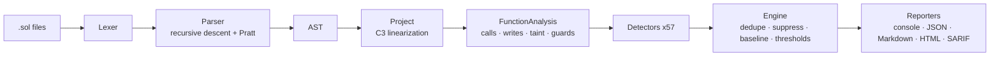

# Architecture

Chainmail is a pure-Python pipeline. It does **not** need `solc`, Node.js or a
compiled project: it parses source text directly, which means it can audit code
that does not compile, uses an exotic compiler version, or is missing its
imports.

## 1. Lexer - `core/lexer.py`

A hand-written, position-aware tokenizer. It keeps comments (needed for inline
suppressions and NatSpec) and records Unicode bidirectional control characters
(U+202E...) so the `rtlo-character` detector can flag "Trojan Source" tricks.

## 2. Parser - `core/parser.py`

* Recursive descent for declarations and statements, a **Pratt parser** for
  expressions (correct precedence and right-associative `**`).
* Supports Solidity 0.4 → 0.8: legacy constructors, `throw`, `var`,
  `.value()()`, call options `{value: ...}`, `try/catch`, `unchecked`, custom
  errors, user-defined value types, `using ... for ... global`, free functions,
  named arguments, array slices.
* Ambiguities (declaration vs. expression statement) are resolved by
  speculative parsing with backtracking.
* **Error tolerance:** a syntax error inside a statement or member is recorded
  as a diagnostic and the parser resynchronises at the next `;` / `}`. The rest
  of the file is still analysed.

Validated against **1 273 real-world files** (OpenZeppelin 5, Uniswap v2/v3,
Solmate, Chainlink) with **zero** parse errors.

## 3. Project model - `core/project.py`

Files are grouped into a `Project`. Every contract gets a `ContractInfo` with
its **C3 linearization** (the same algorithm `solc` uses), so inherited state
variables, modifiers and functions resolve correctly. Bases that are not part of
the scan (e.g. OpenZeppelin imported from `node_modules`) are tracked as
*unresolved* and detectors become more conservative about them.

## 4. Semantic analysis - `core/analysis.py`

`FunctionAnalysis` is computed lazily (and cached) per function and contract:

| Fact | Used by |
|---|---|
| Call sites classified into 15 kinds (low-level call, delegatecall, send, transfer, external, internal, library, builtin, selfdestruct, ...) with call options, loop context and resolved callee | almost every detector |
| State-variable writes and reads in source order, including storage-pointer aliases and `push`/`pop` | reentrancy, access control, gas |
| Value-flow taint seeded from parameters (`x = param`, `abi.decode(param)`, conversions - but *not* storage lookups keyed by a parameter) | delegatecall, arbitrary call/send |
| Access-control guards: resolved modifiers, `require(msg.sender == ...)`, `if (msg.sender != ...) revert`, role checks, `_checkOwner()`, `super` calls | access-control family, reentrancy confidence |
| Lightweight type inference (locals, state, struct members, casts, internal-call return types) | call classification, downcast, ERC20/721 distinction |
| Return-value checking (`require(ok)`, `if (!ok)`, passed to `verifyCallResult`, returned) | unchecked-* detectors |

### Inter-procedural reentrancy

The reentrancy detectors build an ordered effect list for every entry point,
**inlining internal callees** up to depth 3. A state write that appears after
the first external call is reported at the call site in the entry function,
with the path (`via _send()`, `in _clear()`) included in the message.

## 5. Detectors - `detectors/`

Each detector is a small class with metadata (id, severity, confidence,
SWC/CWE, description, recommendation, references) and a `check_contract` /
`check_file` hook. They are registered with `@register`; third-party detectors
are discovered through the `chainmail.detectors` entry-point group.

## 6. Engine - `engine.py`

1. discover files (respecting excludes, tests/scripts/mocks skipped by default),
2. run detectors - **a crashing detector is isolated** and reported, the scan continues,
3. apply severity overrides,
4. deduplicate,
5. apply inline suppressions (`chainmail-disable-next-line`, `-line`, `disable`/`enable` ranges; Slither comments are honoured too),
6. drop findings recorded in a **baseline** (matched by a line-independent fingerprint),
7. apply severity/confidence thresholds and sort.

## 7. Reporters - `reporters/`

* **Console** - colourised, zero dependencies, respects `NO_COLOR`/`FORCE_COLOR`.
* **JSON** - stable machine-readable schema.
* **Markdown** - structured like a professional audit report (IDs C-01, H-02...).
* **HTML** - single self-contained file with severity filters and search.
* **SARIF 2.1.0** - GitHub Code Scanning, with `security-severity`, rule help and partial fingerprints.
